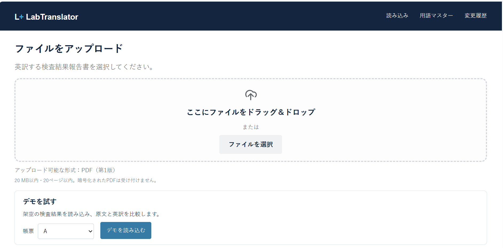
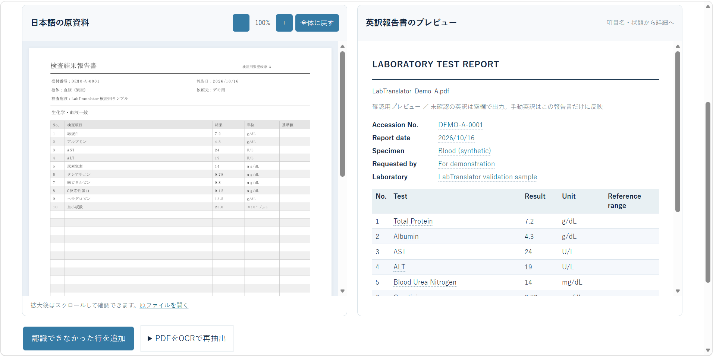
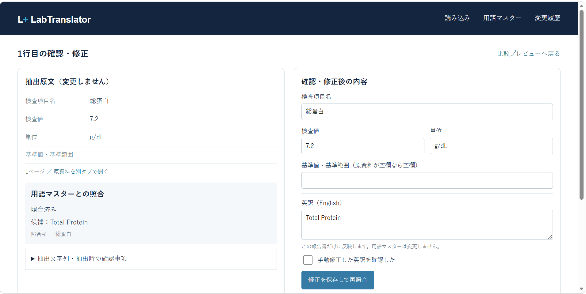
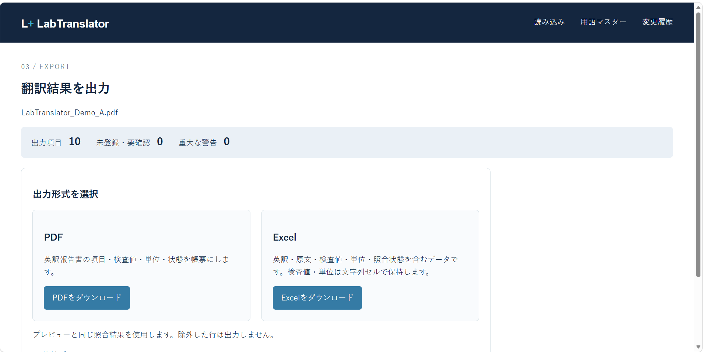

<div align="left">
  
</div>

### Pythonによる検査結果の英訳支援アプリ

**形式も項目名も異なる検査結果を、統一した英語表記へ**

## 概要

LabTranslatorは、日本語の検査結果報告書に記載された検査項目名の表記揺れをPythonで整理し、標準的な英語表記への統一を支援するWebアプリです。

医療機関や検査施設によって異なる検査項目名を、文字列正規化と用語マスターとの照合によって標準化し、翻訳作業の効率化と訳語の一貫性向上を目指しています。

## 医療情報・守秘義務について

本アプリは、**架空の検査結果データのみ**を使用して開発しており、実際の患者情報や業務上の機密情報は使用していません。

医療分野での実務経験から得た問題意識を着想の背景としていますが、医療翻訳業務に共通する一般的な課題をもとに開発しています。

## 開発背景と課題

医療文書に記載される検査結果の翻訳には、次のような課題があります。

- **報告書の形式の違い**  
  医療機関や検査施設によって、報告書の形式や検査項目の配置、表記方法が異なります。

- **PDF・画像からの文字の読み取り**  
  検査結果はExcelやWordなどの編集可能なデータではなく、PDFやスクリーンショットなどの形式で提供されることも多く、検査項目の読み取りや転記に手間がかかります。画像から文字を読み取るOCRを利用する場合も、文字の誤認識が生じることがあります。

- **検査項目名の表記揺れ**  
  同じ検査項目であっても、全角・半角、スペースの有無、漢字・カタカナ、略語など、さまざまな表記揺れが存在します。

  例えば、「総蛋白（Total Protein）」という検査項目には、次のような表記パターンが考えられます。

  | 入力例 | 表記揺れの種類 | 期待する英訳 |
  |---|---|---|
  | 総蛋白 | 基本表記 | Total Protein |
  | 総蛋白質 | 漢字表記の違い | Total Protein |
  | 総タンパク | カタカナ表記 | Total Protein |
  | 総タンパク質 | カタカナ＋漢字 | Total Protein |
  | 総たんぱく | ひらがな表記 | Total Protein |
  | 総たんぱく質 | ひらがな＋漢字 | Total Protein |
  | TP | 英語略語 | TP |
  | ＴＰ | 全角英字 | TP |
  | TP(総蛋白) | 英語略語＋日本語 | TP(Total Protein) |
  | ＴＰ（総タンパク） | 全角英字・全角括弧 | TP(Total Protein) |
  | TP ( 総たんぱく ) | スペースの違い | TP(Total Protein) |

  このように、同じ検査項目でも表記方法が異なるため、単純な文字列の一致だけでは同じ項目として認識できない場合があります。

  また、英語略語と日本語が混在する場合には、英語部分を保持しながら日本語部分だけを翻訳する必要があります。

  ※上記は想定される表記例と期待する英訳であり、すべてのパターンについて実装・動作を保証するものではありません。

- **用語検索の難しさ**  
  文字列の完全一致による検索では、わずかな表記の違いによって該当する用語を取得できない場合があります。

- **用語の登録・管理の負担**  
  表記パターンを個別に登録する方法では、用語数の増加に伴い、登録・検索・更新の負担が大きくなります。


- **翻訳者による訳語のばらつき**  
  同じ検査項目であっても、翻訳者によって使用する英語表現が異なる場合があります。また、同じ翻訳者であっても、過去に使用した訳語と異なる表現を選択することがあります。こうした訳語のばらつきは、翻訳結果の一貫性を損なう原因となります。

これらの課題に対し、LabTranslatorでは、Pythonによる文字列正規化と用語マスターによる照合を組み合わせ、検査項目名の表記揺れに対応するとともに、訳語の統一と翻訳作業の効率化を支援します。

## 開発目的

Pythonによる文字列正規化とデータベースによる用語管理を組み合わせ、検査項目名の表記揺れに対応し、日本語から英語への翻訳を支援することを目的としています。

検査値や単位などの原資料の情報を保持しながら、検査項目の英訳、未登録用語の確認、用語マスターの継続的な更新を可能にすることで、翻訳作業の負担軽減と正確性の向上を目指しています。

## 主な機能

### 1. ファイルの読み込みと検査項目の抽出

**※第1版（v1）ではPDF形式のみ対応**

日本語の検査結果報告書（PDF）を読み込み、検査項目名・検査値・単位・基準範囲などを抽出します。

- PDFファイルの選択、ドラッグ＆ドロップに対応
- 文字情報を含むPDFからのテキスト抽出
- 原資料のPDFプレビュー
- 架空の検査結果報告書A・B・Cによるデモ機能

抽出精度は帳票の構造や文字情報の状態によって異なります。



### 2. 文字列正規化と用語マスターによる英訳

抽出した検査項目名をPythonで正規化し、用語マスターと照合します。

- 全角・半角、スペースなどの表記揺れに対応
- 標準名称と別名による照合
- 用語マスターに登録された英語表記への変換
- 未登録・要確認項目の識別
- 用語マスターの登録・更新と変更履歴の確認

文字列が似ているだけで異なる検査項目を自動的に同一視しないことを重視しています。

### 3. 原資料と英訳結果の比較

原資料のPDFと英訳報告書のプレビューを左右に並べて表示します。

検査項目名だけでなく、検査値・単位・基準範囲、報告書の基本情報も確認できます。

英訳プレビューの項目を選択すると、行ごとの確認・修正画面に移動できます。



### 4. 検査項目ごとの確認・修正

PDFから抽出した検査項目を行単位で確認・修正できます。

- 抽出原文と修正後の内容を並べて表示
- 検査項目名・検査値・単位・基準範囲の修正
- 英訳の手動修正
- 修正内容の保存と再照合
- 抽出できなかった検査行の手動追加

手動修正した英訳は対象の報告書にのみ反映され、用語マスターや他の報告書には影響しません。

修正画面はデモ専用ではなく、読み込んだ報告書から抽出された各行のデータを動的に表示する共通画面です。



### 5. 翻訳結果の出力

確認・修正した翻訳結果を、PDFまたはExcel形式でダウンロードできます。

- **PDF**：英訳報告書として出力
- **Excel**：原文・修正後の検査項目名・英訳・検査値・単位・照合状態などを出力
- 報告書の基本情報も出力対象
- 除外した検査行は出力しない



## 表記揺れへの対応

検査項目名には、漢字・カタカナ・ひらがな、英語略語、全角・半角、スペースや括弧の違いなど、さまざまな表記揺れがあります。

本アプリでは、文字列正規化と用語マスターへの別名登録を組み合わせて対応します。

以下は、表記揺れの例と期待する英訳結果の例です。すべての入力パターンについて動作を保証するものではなく、今後の検証対象も含みます。


### 例1：アルブミン（Albumin）

| 入力例 | 表記揺れの種類 | 期待する英語表記 |
|---|---|---|
| アルブミン | 基本表記 | Albumin |
| 血清アルブミン | 検体情報を含む表記 | Serum Albumin |
| Alb | 英語略語 | Alb |
| Ａｌｂ | 全角英字 | Alb |
| ALB | 大文字表記 | ALB |
| Alb(アルブミン) | 英語略語＋日本語 | Alb(Albumin) |
| Ａｌｂ（アルブミン） | 全角英字・全角括弧 | Alb(Albumin) |
| Alb（アルブミン） | 全角括弧 | Alb(Albumin) |
| ALB（アルブミン） | 大文字・全角括弧 | ALB(Albumin) |
| Alb ( アルブミン ) | スペースの違い | Alb(Albumin) |

※「血清アルブミン」のように検体情報を含む名称は、その情報を削除せず、区別して管理します。

### 例2：総ビリルビン（Total Bilirubin）

| 入力例 | 表記揺れの種類 | 期待する英語表記 |
|---|---|---|
| 総ビリルビン | 基本表記 | Total Bilirubin |
| 総ビリルビン値 | 「値」の有無 | Total Bilirubin |
| T-Bil | 英語略語 | T-Bil |
| T.Bil | 略語の記号の違い | T.Bil |
| Ｔ－Ｂｉｌ | 全角英字・全角記号 | T-Bil |
| T-Bil(総ビリルビン) | 英語略語＋日本語 | T-Bil(Total Bilirubin) |
| Ｔ－Ｂｉｌ（総ビリルビン） | 全角英字・全角括弧 | T-Bil(Total Bilirubin) |
| T-Bil ( 総ビリルビン ) | スペースの違い | T-Bil(Total Bilirubin) |


### 異なる検査項目の誤統一防止

表記揺れを統一する一方で、名称が似ていても医学的に異なる検査項目は、区別する必要があります。

例えば、以下の3つは異なる検査項目です。

| 検査項目 | 英語名 |
|---|---|
| 総ビリルビン | Total Bilirubin |
| 直接ビリルビン | Direct Bilirubin |
| 間接ビリルビン | Indirect Bilirubin |

LabTranslatorでは、部分的に文字列が一致するだけで同一の検査項目と判断しないことを基本方針としています。

## 使用技術

| 分類 | 技術 |
|---|---|
| 言語 | Python |
| Webフレームワーク | Flask |
| データベース | SQLite |
| データベース操作 | SQLAlchemy |
| Excel処理 | openpyxl |
| PDF処理 | pdfplumber、Poppler |
| PDF出力 | ReportLab |
| 文字列処理 | unicodedata、re |
| OCR連携 | Tesseract OCR |
| テスト | pytest、Node.jsによるJavaScriptテスト |
| 画面 | HTML、CSS、JavaScript |

## 開発状況

LabTranslatorは現在開発中のプロトタイプです。

PythonとFlaskを使用したローカル実行用のWebアプリとして開発しており、架空の検査結果報告書を用いた機能検証を進めています。

現時点では一般公開環境へのデプロイは行っていません。

### 外部ツールについて

- **Poppler**：PDFの原本画像プレビューなどに使用します。
- **Tesseract OCR**：画像化PDFのOCR処理に使用します。日本語・英語の言語データが必要です。
- **TrueTypeフォント**：PDF出力に必要です。環境によっては `PDF_FONT_PATH` の設定が必要です。

文字情報を含むPDFの抽出と、画像化PDFのOCRでは必要な外部ツールが異なります。

## テスト・検証状況

2026年10月16日時点の検証結果です。

| 項目 | 結果 |
|---|---|
| Pythonテスト | 99件成功・0件失敗・6件スキップ |
| JavaScriptテスト | 6件成功・0件失敗 |
| PDFデモA・B・C | 読み込み・照合・比較表示を検証 |
| PDF・Excel出力 | 出力結果を確認 |
| 実際のOCR精度 | 未検証 |
| macOS・Linux | 未検証 |

Pythonテストのスキップ6件は、検証環境にTesseractが導入されていないことによるものです。

テストを実行する場合は、開発用依存ライブラリをインストールします。

```powershell
python -m pip install -r requirements-dev.txt
python -m pytest
```

JavaScriptテストにはNode.jsが必要です。実行方法は開発資料を参照してください。

## 現在の制限事項

- 通常アップロードはPDF形式のみ対応しています。
- PDFのレイアウトや文字情報の状態によって、検査項目を正しく抽出できない場合があります。
- 画像化PDFのOCR処理は接続されていますが、実際のOCR精度は未検証です。
- OCR誤認識に対する修正候補の自動提示は未実装です。
- 原資料と同一のレイアウトを維持した英訳PDFの生成には対応していません。
- 認証機能や患者情報の匿名化・マスキング機能は実装していません。
- 実際の患者情報を扱う運用やインターネット公開環境での利用を想定していません。

## 今後の開発予定

- 画像化PDFのOCR実動作・認識精度の検証
- PNG・JPG画像の直接読み込み
- OCR誤認識が疑われる用語の候補提示
- 複雑な帳票や複数ページPDFへの対応改善
- 原資料と英訳項目の対応関係を確認しやすいUIの改善
- 検査項目数の多い報告書での抽出・照合精度の検証
- 原資料のレイアウトを可能な範囲で維持した英訳結果の出力

## 設計資料

- [要件定義書](docs/requirements.md)
- [デモデータ設計](docs/demo_data_design.md)
- [データベース設計](docs/database_design.md)
- [開発・実行手順](docs/development.md)

※設計資料には開発途中の検討事項も含まれます。現在の実装状況については、本READMEの「主な機能」「現在の制限事項」を参照してください。